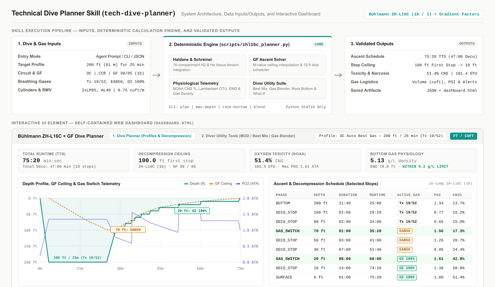

# Technical Dive Planner Skill (`tech-dive-planner`)

## 1. Overview

`tech-dive-planner` is a deterministic technical scuba dive planning skill and interactive dashboard for Open Circuit (`OC`), Closed Circuit Rebreather (`CCR`), and `CCR -> OC` Bailout diving. It implements Dr. Albert A. Bühlmann's ZH-L16C 16-compartment dissolved-gas decompression model with Erik C. Baker's Gradient Factors (`GF Low` and `GF High`).



### Core Technical Capabilities
- **Bühlmann ZH-L16C + Gradient Factors (`1b` and `1`)**: Solves exact Haldane (isobaric) and Schreiner (linear depth-change) differential gas transport equations across all 16 nitrogen and helium tissue compartments (`1b` default, `1` selectable).
- **Physiological Telemetry**: Tracks NOAA 7-segment piecewise linear Central Nervous System (`CNS %`) oxygen toxicity (including 90-minute half-time surface interval decay), Lambertsen/Baker Pulmonary Oxygen Toxicity Units (`OTU`), Equivalent Air Depth (`EAD`), Equivalent Narcotic Depth (`END` with configurable narcotic $\text{O}_2$), and breathing gas density ($\text{g/L}$) against UHMS/DAN thresholds (`5.2 g/L` recommended limit, `6.2 g/L` critical limit).
- **Diver Query Variants & Utility Calculators**: Covers automatic optimal gas selection (`plan --auto-best-gas`), tank-to-depth envelope calculation (`max-depth`), no-decompression and tank-limited bottom time (`max-time`), Minimum Reserve Gas ("Rock Bottom", `rock-bottom`), Gradient Factor and lost-gas sensitivity (`what-if`), repetitive dive chaining (`repetitive`), CCR bailout stage sizing (`bailout-sizing`), `EAD`/`END`/`MOD`/`MinOD`/`MND`/Density (`gas-tools`), Best Mix (`best-mix`), and Nitrox/Trimix partial-pressure and top-up gas blending (`blend`).
- **Interactive HTML Dashboard & Profile Management**: Generates a self-contained `dashboard.html` via `scripts/build_dashboard.py` with live client-side ZH-L16C + GF recalculation, Light/Dark/System themes, and custom profile saving/recalling via both the web browser and CLI (`profiles --action list|save|delete`).

---

## 2. Project Structure

All paths are relative to the project root directory:

```text
.
|-- DESIGN.md
|-- LICENSE
|-- PRD.md
|-- README.md
|-- SKILL.md
|-- dashboard.html
|-- requirements.txt
|-- assets/
|   |-- dive_plan_schema.json
|   |-- skill_overview.png
|   `-- synthetic_dive_profiles.json
|-- documents/
|   `-- prd.md
|-- references/
|   `-- zhl16c_math_reference.md
|-- scripts/
|   |-- __init__.py
|   |-- build_dashboard.py
|   `-- zhl16c_planner.py
`-- tests/
    |-- __init__.py
    |-- run_tests.py
    |-- test_smoke.py
    |-- test_system_e2e.py
    `-- test_unit_zhl16c.py
```

### Directory and File Descriptions
- `SKILL.md`: Primary skill definition, operational workflow, and CLI subcommand mapping.
- `DESIGN.md`: Architectural visual design specification for the HTML dashboard.
- `PRD.md` and `documents/prd.md`: Product Requirement Document detailing user stories, technical architecture, functional/non-functional requirements, and error handling.
- `LICENSE`: Apache License 2.0 terms and conditions governing the project.
- `dashboard.html`: Self-contained interactive HTML5 dive planner and gas calculator dashboard.
- `requirements.txt`: Python package list (core calculations use the Python Standard Library; optional test runners are listed for convenience).
- `assets/dive_plan_schema.json`: JSON Schema defining the input configuration and output schedule structure.
- `assets/skill_overview.png`: Architectural and dashboard overview diagram illustrating the skill execution pipeline, data inputs/outputs, and interactive UI preview.
- `assets/synthetic_dive_profiles.json`: Reference technical dive profiles and cylinder presets loaded by the CLI and dashboard.
- `references/zhl16c_math_reference.md`: Mathematical reference covering ZH-L16C (`1b` and `1`) coefficients, Haldane/Schreiner equations, Gradient Factors, NOAA CNS, and Lambertsen OTU formulas.
- `scripts/zhl16c_planner.py`: Deterministic ZH-L16C + GF decompression engine, gas utility calculators, and profile manager CLI.
- `scripts/build_dashboard.py`: Generator script that embeds the reference profiles into `dashboard.html`.
- `tests/run_tests.py`, `tests/test_unit_zhl16c.py`, `tests/test_smoke.py`, `tests/test_system_e2e.py`: Automated unit, smoke, and end-to-end system test suite.

---

## 3. User Guide for Non-Technical Users

You do not need programming experience to plan a dive, check cylinder limits, blend breathing gases, or save custom dive profiles. You can use this skill in two ways: by asking questions in plain English through your agent chat interface, or by opening `dashboard.html` directly in your web browser.

### 3.1 Asking Questions in Plain English (Agent Chat)

When this skill is loaded in your agent workspace, state your dive parameters or question in everyday diving terms. The assistant automatically runs the underlying decompression and gas physics calculations and explains the results.

#### Example 1: Planning a Deep Dive and Finding the Best Gas
- **What you can ask**:
  > "I want to do an open-circuit wreck dive to 200 feet for 25 minutes using Gradient Factors 30/85. What bottom gas and decompression gases should I bring, and what will my decompression stops look like?"
- **What you receive**:
  - **Recommended Bottom Gas**: `Tx 19/52` (`19% Oxygen / 52% Helium / 29% Nitrogen`), which keeps your bottom oxygen partial pressure at `1.34 ATA`, your Equivalent Narcotic Depth (`END`) at `78.8 ft`, and your gas density at `5.13 g/L` (along with the closest standard dive-shop blend such as `Tx 18/45` or `Tx 15/55`).
  - **Recommended Decompression Gases**: `EAN50` (`50% Oxygen`, switch at `70 ft`) and `O2 100%` (`100% Oxygen`, switch at `20 ft`).
  - **Complete Ascent Schedule**: A stop-by-stop table starting at `100 ft` all the way to the `10 ft` last stop, showing exact stop times (`47 minutes` total decompression, `75 minutes 20 seconds` total run time), oxygen toxicity (`CNS 51.4%`, `OTU 101.4`), and how many cubic feet or PSI of gas you need in each tank.

#### Example 2: Checking How Deep You Can Go on a Specific Tank
- **What you can ask**:
  > "I have a single Aluminum 80 tank filled to 3000 psi with 32% Nitrox (EAN32). If I limit my working oxygen exposure to 1.4 ATA and keep one-third of my tank in reserve, how deep can I go and how long can I stay before needing decompression stops?"
- **What you receive**:
  - **Maximum Operating Depth (`MOD`)**: `111.5 ft` (limited by oxygen exposure reaching `1.40 ATA`).
  - **Usable Gas**: `51.6 cubic feet` of usable gas (`2000 psi` turn pressure, keeping `1000 psi` / `25.8 cubic feet` in reserve).
  - **Depth-by-Depth Table**: A breakdown from `30 ft` to `120 ft` in `10 ft` steps comparing your No-Decompression Limit (`NDL`) against your tank-limited bottom time so you can see whether your lungs or your computer limit the dive at each depth.

#### Example 3: Calculating Emergency Turn Pressure ("Rock Bottom")
- **What you can ask**:
  > "My buddy and I are diving twin LP85 tanks filled to 2640 psi to a depth of 180 feet for 25 minutes, switching to our 50% Nitrox deco bottle at 70 feet. If one of us has a catastrophic regulator failure at the end of the bottom time, how much gas do we need to get both of us up to the 70-foot gas switch?"
- **What you receive**:
  - **Rock Bottom Reserve**: `44.9 cubic feet` (`698 psi`), which covers two stressed divers breathing from one twinset for 1 minute at `180 ft` to resolve the problem, ascending from `180 ft` to `70 ft`, and completing the deep stops along the way.
  - **Minimum Turn Pressure**: Tells you the exact pressure reading on your submersible pressure gauge (`SPG`) at which you must begin your ascent.

#### Example 4: Filling and Blending Tanks at the Fill Station
- **What you can ask**:
  > "My twinset still has 500 psi of Trimix 18/45 left in it from yesterday. I want to top it up to 2640 psi of Trimix 21/35 using pure Helium, pure Oxygen, and Air. Give me the fill steps."
- **What you receive**:
  - **Step 1**: Keep all `500 psi` currently in the tank (zero bleed-down required).
  - **Step 2 (Helium)**: Add `+699.0 psi` of Helium to reach `1199.0 psi` on the gauge.
  - **Step 3 (Oxygen)**: Add `+198.2 psi` of Oxygen to reach `1397.2 psi` on the gauge.
  - **Step 4 (Air Top-Up)**: Fill with clean compressed Air (+`1242.8 psi`) to finish at `2640.0 psi`.

#### Example 5: Saving a Dive Plan to the Profile Dropdown Selector
- **What you can ask**:
  > "Plan an open-circuit dive to 165 feet for 30 minutes on Trimix 21/35 with EAN50 and Oxygen deco, and save it to my Profile dropdown list as 'Wreck 165ft - 30 min'."
- **What happens**:
  The assistant runs the dive plan, saves your custom configuration into `assets/synthetic_dive_profiles.json`, and updates `dashboard.html` so that **"Wreck 165ft - 30 min"** appears immediately in the **Profile** dropdown menu whenever you open the dashboard.

---

### 3.2 Using the Interactive Web Dashboard (`dashboard.html`)

Open `dashboard.html` in any web browser (double-click the file in your file manager). No internet connection or local server is needed. The main page is organized into two primary workspace tabs at the top of the screen:

1. **Main Tab 1 (`1. Dive Planner (Profiles, Gases & Decompression Schedule)`)**:
   - **Open or Create a Profile**: Select an existing dive profile from the top **Profile** dropdown menu, or click **`New Profile`** (`New`) to start a fresh dive plan profile.
   - **Choose Units and Dive Mode**: Toggle between **Imperial (`FT / CUFT`)** and **Metric (`M / LITERS`)**, and switch between **`OC (Open Circuit)`** and **`CCR (Rebreather)`**.
   - **Enter Depth, Time, and Gases**: Set your target depth and bottom time, adjust **`GF Low`** and **`GF High`**, and configure your bottom, travel, decompression, or CCR bailout cylinders in **Gas Mixes & Bailout Inventory** (or click **`Auto Best Gas + Plan`** to populate optimal gases automatically).
   - **Review Ascent & Telemetry**: View the 4 KPI summary cards, the interactive depth and decompression ceiling chart, and the sub-tabs for **Ascent & Decompression Table**, **Cylinder Gas Logistics**, and **16-Compartment Tissue Matrix**.
   - **Save and Recall Custom Profiles**: Type a custom name into **Profile Title** and click **`Save Profile`** (`Save`) to persist the profile in your browser's **Profile** dropdown menu. Use **Export JSON** and **Import JSON** to back up or share profile files.
2. **Main Tab 2 (`2. Diver Utility Tools (MOD / Best Mix / Gas Blender / Rock Bottom)`)**:
   - Switches to a dedicated full-width calculators screen with four sub-tabs:
     - **`Tool 1 & Var 2: EAD / END / MOD & Tank Max-Depth`**: Calculates Maximum Operating Depth (`MOD`), Minimum Operating Depth (`MinOD`), Equivalent Air Depth (`EAD`), Equivalent Narcotic Depth (`END`), Maximum Narcotic Depth (`MND`), and maximum depth supported by your selected cylinder.
     - **`Tool 2: Best Mix for Depth`**: Calculates optimal Nitrox or Trimix fractions for any target depth, $P_{\text{O}_2}$, and `END` limit.
     - **`Tool 3: Nitrox / Trimix Blender & Fill Capacity`**: Calculates step-by-step partial-pressure gas blending (`Helium`, `Oxygen`, and `Air` top-up) and bleed-down pressures over partially full cylinders.
     - **`Tool 4 & Var 3: Gas Density, Rock Bottom & What-If`**: Calculates two-diver emergency reserve gas ("Rock Bottom") to reach the first decompression gas switch and repetitive surface interval `CNS %` decay.

---

## 4. Technical Setup & Command-Line Usage

### 4.1 Prerequisites
- **Operating System**: Standard desktop or server operating system supporting Python `3.10` or newer.
- **Python Version**: Python `3.10` or newer.
- **Dependencies**: Core execution (`scripts/zhl16c_planner.py`, `scripts/build_dashboard.py`, and `tests/run_tests.py`) relies exclusively on the Python Standard Library (`math`, `dataclasses`, `json`, `argparse`, `unittest`). Optional test runners are listed in `requirements.txt`.

```bash
python3 -m venv .venv
source .venv/bin/activate
pip install -r requirements.txt
```

### 4.2 Running the Automated Test Suite
Execute the unit, smoke, and end-to-end system test suite from the project root directory (returns exit code `0` on success):

```bash
python3 tests/run_tests.py
```

Or run via standard `unittest` discovery:

```bash
python3 -m unittest discover -s tests -v
```

### 4.3 CLI Subcommand Examples

All commands are executed from the project root directory:

```bash
# Variant 1: Given depth and time, compute optimal bottom/deco gases and full decompression plan
python3 scripts/zhl16c_planner.py plan --depth 200 --time 25 --auto-best-gas

# Variant 2: Given tank size and gas mix, calculate maximum safe operating depth and NDL/gas envelope
python3 scripts/zhl16c_planner.py max-depth --cylinder AL80 --fill-psi 3000 --f-o2 0.32 --f-he 0.0

# Variant 3A: Solve for NDL, tank-limited bottom time, and CNS limit at a target depth
python3 scripts/zhl16c_planner.py max-time --depth 100 --f-o2 0.32 --cylinder AL80 --fill-psi 3000

# Variant 3B: Calculate Minimum Gas ('Rock Bottom') and Turn Pressure for two divers sharing gas
python3 scripts/zhl16c_planner.py rock-bottom --depth 180 --time 25 --cylinder 2xLP85 --fill-psi 2640 --switch-depth 70

# Variant 3C: Compare Gradient Factor pairs and Lost Decompression Gas scenarios
python3 scripts/zhl16c_planner.py what-if --depth 180 --time 25 --f-o2 0.18 --f-he 0.45

# Variant 3D: Chain Dive 1 -> Surface Interval -> Dive 2
python3 scripts/zhl16c_planner.py repetitive --d1-depth 130 --d1-time 25 --surface-interval 90 --d2-depth 100 --d2-time 25 --f-o2 0.32

# Variant 3E: Calculate CCR loop failure OC bailout schedule and stage cylinder recommendations
python3 scripts/zhl16c_planner.py bailout-sizing --depth 240 --time 30 --f-o2 0.13 --f-he 0.54

# Tool 1 & Tool 4: Calculate EAD, END, MOD, MinOD, MND, Gas Density (g/L), and MDD
python3 scripts/zhl16c_planner.py gas-tools --depth 200 --f-o2 0.18 --f-he 0.45 --o2-narcotic true

# Tool 2: Calculate Best Nitrox, Best Trimix, and closest standard agency mix for depth
python3 scripts/zhl16c_planner.py best-mix --depth 200 --max-po2 1.40 --max-end 100 --max-density 5.20

# Tool 3: Calculate Trimix/Nitrox partial-pressure cascade blending, bleed-down, and fill capacity
python3 scripts/zhl16c_planner.py blend --mode partial_pressure --cylinder 2xLP85 --start-pressure 500 --start-f-o2 0.18 --start-f-he 0.45 --target-pressure 2640 --target-f-o2 0.21 --target-f-he 0.35

# Save a planned dive directly into the UI Profile dropdown selector and rebuild dashboard.html
python3 scripts/zhl16c_planner.py plan --depth 165 --time 30 --f-o2 0.21 --f-he 0.35 --save-profile-id custom-wreck-165ft --save-profile-title "OC Tx 21/35 - 165 ft for 30 min"

# Manage saved profiles via the profiles subcommand (list, save, delete)
python3 scripts/zhl16c_planner.py profiles --action list
python3 scripts/zhl16c_planner.py profiles --action save --profile-id custom-200ft --title "OC 200ft Best Gas" --depth 200 --time 25 --auto-best-gas
python3 scripts/zhl16c_planner.py profiles --action delete --profile-id custom-200ft

# Regenerate the standalone HTML dashboard
python3 scripts/build_dashboard.py
```

---

## 5. License

This project is licensed under the Apache License, Version 2.0. See the [`LICENSE`](LICENSE) file for details.
